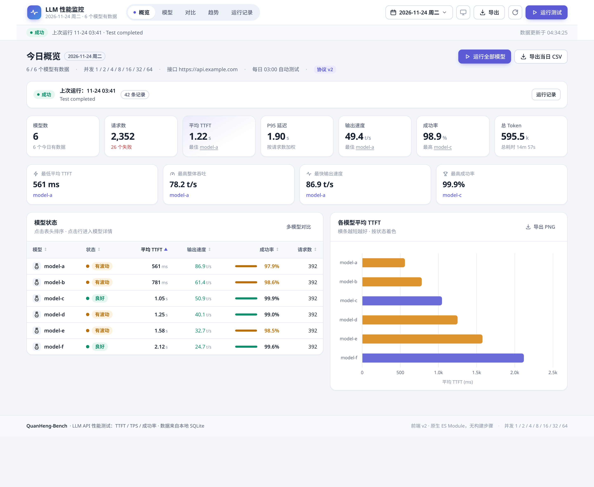

# QuanHeng-Bench

**Zero-dependency, single-binary LLM inference load tester with a built-in baseline dashboard.**

QuanHeng-Bench drives real streaming traffic at a ladder of concurrency levels against any
OpenAI-compatible endpoint, measures TTFT / output speed / throughput / success rate per
model, stores one snapshot per day in SQLite, and serves its own dashboard — trends,
model comparison, error attribution and CSV export included. No Python, no GPU stack, no
external database, no frontend build step.



<sub>More: [model detail](docs/screenshots/model.png) · [dark mode](docs/screenshots/model-dark.png) · [compare](docs/screenshots/compare.png) · [trend](docs/screenshots/trend.png) · [runs](docs/screenshots/runs.png) · [mobile](docs/screenshots/mobile-overview.png)</sub>

## Features

- **Single static binary** — Rust + bundled SQLite; the dashboard is embedded in the same
  file. `scp` it to a server and run it.
- **Auto-discovery** — reads `/v1/models`, then tests every model at
  `1,2,4,8,16,32,64` concurrency (configurable), with enough samples at low concurrency
  that P99 means something.
- **Two token sources, negotiated** — asks for exact `usage.completion_tokens` and records
  which caliber was used (`usage` / `estimate`); a gateway that rejects the field is
  detected once and the fallback is labelled, never silently mixed.
- **Cold-prefill caliber** — prefix-cache busting (head nonce + per-level question rotation
  + discarded warm-up) so TTFT reflects a real first user, not a cache hit.
- **Fixed measurement coordinates** — `INPUT_TOKENS` / `OUTPUT_TOKENS` pin the (in, out)
  budget so numbers from different environments are comparable.
- **Error attribution** — 401/429/5xx/timeout/empty-stream are counted separately and
  grouped into up to five signatures per row, instead of silently lowering a success rate.
- **Daily baselines** — scheduled runs + per-day snapshots (plus a `run_log` of every run),
  so "is this model slower than last week" is a chart, not a memory.
- **Operable** — cancel a run mid-flight (≤250 ms), per-model progress, optional bearer
  token, `/healthz`, cache/security headers, dual-arch container images.
- **No JS build chain** — plain ES modules and CSS variables, Chart.js vendored locally.
  Dark mode, keyboard-navigable tabs, mobile layout.

## Why another LLM benchmark?

| | Python research frameworks<br>(genai-perf, evalscope, vllm bench) | Generic load testers<br>(k6, vegeta, locust) | **QuanHeng-Bench** |
|---|---|---|---|
| Install | Python env + deps | separate tool + scripting | one binary / one image |
| Streaming TTFT | ✅ | needs custom code | ✅ |
| Auto model discovery | partial | ❌ | ✅ |
| History & trends out of the box | ❌ | ❌ | ✅ daily snapshots |
| Error taxonomy | partial | ❌ | ✅ per row |
| Runs on a small VM with SQLite | partial | ✅ | ✅ |

It is deliberately **not** a dataset-fidelity/academic benchmark: it is the tool you leave
running next to a gateway to answer "which backend regressed this week".

## Quick start

### Docker (recommended)

```bash
docker run -d --name quanheng-bench -p 3000:3000 \
  -v "$PWD/data:/app/data" \
  -e BASE_URL=http://192.0.2.10:8000 \
  quanheng-bench:v0.3.0-amd64
```

Open <http://localhost:3000> and press **运行测试** — no login, no token.

> `BASE_URL` is the API root **without** `/v1` — QuanHeng-Bench appends `/v1/models` and
> `/v1/chat/completions` itself.

### From source

```bash
cargo build --release
BASE_URL=http://localhost:8000 ./target/release/quanheng
```

The binary needs `assets/` and `icons/` next to the working directory (or set `ASSETS_DIR`).
Templates are compiled in.

## What it measures

| Metric | Definition |
|---|---|
| **TTFT** | time from request start to the first non-empty `content` **or** `reasoning`/`reasoning_content` delta — thinking models are not penalised for silence |
| **Output speed** | completion tokens ÷ (total time − TTFT): how fast the model streams once it starts |
| **Throughput** | completion tokens ÷ total time: what the client actually perceives |
| **P50 / P95 / P99 TTFT** | linear-interpolated percentiles over successful requests in that level |
| **Success rate** | successful ÷ attempted, with failures broken down by error signature |
| **Merged records** | if `TEST_RUNS > 1`, counts/tokens/duration are summed and latency is weighted by successful requests |

Each row is one `(date, model, concurrency)`. Requests per level are
`max(3× / 2× / 1× concurrency, REQUESTS_PER_LEVEL)`, so low levels get a real sample size.

## Dashboard

| View | What it is for |
|---|---|
| **概览 Overview** | KPI cards, best/worst model, per-model status, TTFT ranking |
| **模型 Model** | full table (requests, errors, TTFT, percentiles, speeds, tokens, success), 4 charts, CSV export, re-test one model |
| **对比 Compare** | overlay 2–6 models on TTFT/TPS, normalised radar, side-by-side table |
| **趋势 Trend** | any metric over 7/30/all days, optionally pinned to one concurrency |
| **运行记录 Runs** | run log, live per-model progress, cancel, auto-refresh |

Every chart can export PNG; the date picker is searchable; the URL carries the view, date
and selection so refreshes don't lose context.

## Configuration

All settings are environment variables (a YAML file is on the roadmap).

| Variable | Default | Description |
|---|---|---|
| `BASE_URL` | `http://localhost:8000` | OpenAI-compatible API root, **without** `/v1` |
| `API_KEY` | – | Bearer key used for discovery and chat requests |
| `HOST` / `PORT` | `0.0.0.0` / `3000` | Listen address |
| `DB_PATH` | `data/records.db` | SQLite file (auto-migrated on start) |
| `CONCURRENCY_LEVELS` | `1,2,4,8,16,32,64` | Concurrency ladder |
| `REQUESTS_PER_LEVEL` | `10` | Floor per level (`0` = ladder formula only) |
| `TEST_RUNS` | `1` | Rounds per level, merged into one row |
| `QUESTIONS_PER_RUN` | `20` | Random prompts per run from the built-in bank |
| `MAX_TOKENS` | `512` | Output cap per request |
| `MAX_PARALLEL_MODELS` | `8` | Models tested simultaneously (1–32) |
| `MODELS_CACHE_SECS` | `60` | `/v1/models` cache TTL |
| `STREAM_INCLUDE_USAGE` | `auto` | `auto` probes the endpoint once per run and asks for exact `usage` if it is accepted (a 4xx rejection falls back to estimation); `true` always sends, `false` never does |
| `CACHE_BUST` | `true` | Defeat prefix KV caching: unique nonce at the **head** of every prompt + a fresh question set per concurrency level |
| `WARMUP_REQUESTS` | `2` | Discarded warm-up requests per (model, level); only with `CACHE_BUST=1` |
| `INPUT_TOKENS` | `0` | Target input length in tokens (`0` = question bank as-is); sized without a tokenizer (~±15%) |
| `OUTPUT_TOKENS` | `0` | Output budget, overrides `MAX_TOKENS` when set |
| `REQUEST_TIMEOUT_SECS` | `1800` | Per-request timeout |
| `RUN_ON_START` | `true` | Run once at startup if today has no data |
| `TZ_OFFSET_HOURS` | `8` | Timezone used for `test_date` and schedules |
| `SCHEDULED_HOUR` / `SCHEDULED_MINUTE` | `3` / `0` | Daily run time (local) |
| `CORS_ORIGINS` | – | Comma-separated allow-list; empty = same-origin only |
| `ASSETS_DIR` | auto | Where `assets/` and `icons/` live |

## HTTP API

| Method | Path | Purpose |
|---|---|---|
| GET | `/healthz` | Liveness + DB probe (no auth) |
| GET | `/api/dashboard?date=` | Everything the dashboard needs for one day |
| GET | `/api/status` | Run state, per-model progress, elapsed time |
| GET | `/api/models?refresh=1` | Upstream model list (cached, stale-on-error) |
| GET | `/api/trend?model=&metric=&concurrency=` | Daily series |
| GET | `/api/run-log?limit=` | Run history |
| GET | `/api/export.csv?date=&model=` | CSV export |
| POST | `/api/run-test` | Start a full run (409 if one is active) |
| POST | `/api/run-model` | `{"model":"…"}` single-model run |
| POST | `/api/cancel` | Cancel the active run |
| GET | `/api/config` | Effective configuration |

Legacy endpoints (`/api/today`, `/api/history/:date`, `/api/dates`) are kept for scripts.
There is no authentication: every endpoint is open to whoever can reach the port, so bind it to a
trusted network or put it behind your own authenticating reverse proxy.

## Use it from an AI agent or a script

There is no login and no token: the JSON API is the same one the UI uses, so anything that
can `curl` can read the measurements.

- **[`skills/quanheng-bench/SKILL.md`](skills/quanheng-bench/SKILL.md)** — an Agent Skill
  describing when to call which endpoint, how to read the caliber fields
  (`protocol_version` / `token_source` / `cache_bust` / in-out coordinates), how to trigger
  and poll a run, and how to report numbers without over-claiming.
- Point an agent at the file, or feed it the URL of a running instance.

```bash
B=http://localhost:3000
curl -s $B/api/dashboard | jq '.summary'      # headline numbers for today
curl -s "$B/api/trend?model=model-a&metric=ttft&concurrency=8"
curl -s -X POST $B/api/run-test               # 409 if a run is already in flight
curl -s $B/api/status | jq '{running, progress}'
```

## Docker images

**Pull from GitHub Container Registry** (multi-arch manifest — `docker` picks the right one):

```bash
docker pull ghcr.io/diannaojiang/quanheng-bench:b1
docker run -d --name quanheng-bench -p 3000:3000 -v "$PWD/data:/app/data" \
  -e BASE_URL=http://192.0.2.10:8000 ghcr.io/diannaojiang/quanheng-bench:b1
```

**Or load an offline tarball** — releases also ship two single-arch tarballs with distinct
tags, so both can be loaded on the same Docker host:

```bash
docker load -i quanheng-bench-v0.3.0-amd64.tar.gz   # -> quanheng-bench:v0.3.0-amd64
docker load -i quanheng-bench-v0.3.0-arm64.tar.gz
```

Build them yourself — **no QEMU/binfmt required**:

```bash
./build.sh -v v0.3.0 -o ./dist      # amd64 + arm64
./build.sh -p linux/amd64 -o ./dist # one platform
```

The Dockerfile cross-compiles aarch64 on the build platform and keeps every target-arch
step as a pure `COPY` (CA certificates and tzdata are architecture-independent Debian
packages prepared once), which is what makes emulator-free multi-arch builds possible.

## Running next to a gateway

QuanHeng-Bench is a sidecar, not a router plugin. A typical deployment with an LLM gateway
(e.g. QueQiao-Router) on the same host:

```yaml
services:
  quanheng-bench:
    image: quanheng-bench:v0.3.0-amd64
    network_mode: host          # or join the gateway's compose network
    volumes: ["./quanheng-bench-data:/app/data"]
    environment:
      BASE_URL: http://127.0.0.1:8000   # the gateway itself
      SCHEDULED_HOUR: "3"
```

This measures end-to-end behaviour through the gateway. Per-backend matrices (importing a
gateway's backend list and testing each upstream directly) are planned for v1.0.

## Measurement protocol

Numbers are only comparable when their caliber is comparable, so every row records the
caliber it was produced under (`protocol_version`, `token_source`, `cache_bust`) and the
UI labels it.

| | protocol v1 (≤ v0.2.x) | protocol v2 (v0.3.0+) |
|---|---|---|
| Token count | estimate only by default | `usage` negotiated; estimate only as labelled fallback |
| Prefix KV cache | not handled — repeated prompts hit the cache | busted: unique head nonce + per-level question set |
| Warm-up | none | `WARMUP_REQUESTS` discarded before measuring |
| Input/output size | whatever the question bank gives | `INPUT_TOKENS` / `OUTPUT_TOKENS` pinned |
| Provenance | none | recorded per row and shown as badges |

> **Expect higher TTFT after upgrading.** v1 numbers from a server with prefix caching
> enabled are cache-hit calibers — most requests reused the same prompt prefix, so they
> describe a warm cache rather than a first user. v2 measures cold prefill; that is a
> correction, not a regression. Do not draw one line through v1 and v2 points.

## Methodology & caveats

- **Token source matters.** With `usage` the TPS is exact; without it QuanHeng-Bench
  estimates (1 per CJK character, ~4 non-space chars per token, roughly ±15%) and marks
  the row `estimate`. `SELECT * FROM endpoint_capabilities` shows what this endpoint does.
- **`INPUT_TOKENS` is approximate without a tokenizer.** The prompt is padded to
  `tokens × 4` characters while the estimate ignores whitespace, so the measured input
  length lands a little under the target. Exact sizing needs the tokenizer (roadmap).
- **Concurrency ladder ≠ arrival rate.** It finds saturation; it does not simulate a
  fixed QPS. An RPS mode is planned.
- **Cache busting is deliberate overhead.** A unique prompt per request means no cache can
  help you; that is the point when you want cold-prefill latency, and the wrong caliber
  when you want to measure the cache-hit path (set `CACHE_BUST=false` and label the run).
- **Don't benchmark services you don't own** without permission.
- The built-in question bank is English and thinking-heavy by design (long outputs).

## Roadmap to v1.0

- [ ] YAML config file (multi-endpoint, targets, datasets) with env overrides
- [ ] Prompt datasets (JSONL / plain text / ShareGPT) alongside the built-in bank
- [ ] Arrival-rate (RPS) mode + warmup/discard window
- [ ] Prometheus `/metrics` and SLA thresholds with non-zero exit codes
- [ ] Per-backend matrix (import a gateway's backend list)
- [ ] Optional tokenizer integration (tiktoken / HF tokenizers)

## Development

```bash
cargo fmt --all
cargo clippy --all-targets -- -D warnings
cargo test --all-targets
cargo build --release
```

Layout: `src/tester.rs` (load engine + SSE), `src/db.rs` (SQLite + migrations),
`src/routes.rs` (API/auth), `templates/` + `assets/` (dashboard), `build.rs` (embeds
templates at compile time). See [AGENTS.md](AGENTS.md) for the full architecture notes and
[docs/API_CONTRACT.md](docs/API_CONTRACT.md) for the JSON contracts.

## License

[Apache-2.0](LICENSE). See [NOTICE](NOTICE) for bundled assets and trademark notes.

---

## 中文速览

QuanHeng-Bench 是一个**单二进制、零依赖**的 OpenAI 兼容推理压测器：自动发现模型，在
1/2/4/8/16/32/64 并发下打流式真实请求，测 TTFT、输出速度、吞吐、成功率与错误归因，
按天落 SQLite，并自带仪表板（概览 / 模型 / 对比 / 趋势 / 运行记录，深色模式、CSV 导出、可取消）。

```bash
docker run -d --name quanheng-bench -p 3000:3000 \
  -v "$PWD/data:/app/data" \
  -e BASE_URL=http://192.0.2.10:8000 \
  quanheng-bench:v0.3.0-amd64
```

`BASE_URL` 不要带 `/v1`。服务默认**无鉴权**（API 可直接 curl 调用），请只监听内网或置于反向代理之后。
当前版本为 v0.3.0（预发布），v1.0 计划补齐 YAML 配置、数据集、RPS 模式、Prometheus 与
SLA 退出码。欢迎 issue / PR。
